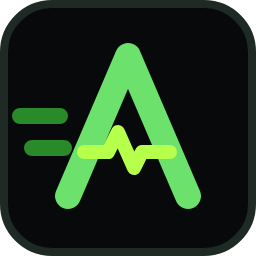

<p align="center">
  
</p>

<h1 align="center">Open Apexpress</h1>
<p align="center"><b>Vos conteneurs sur ECLYPSE APEX, en express.</b><br>
Un seul fichier à lancer : vous choisissez les services, Open Apexpress installe tout sur l'automate.</p>

<p align="center"><i>English summary at the end.</i></p>

---

L'[ECLYPSE APEX](https://distech-controls.com/products/detail/947888/eclypse-apex) de Distech Controls fait tourner des conteneurs Docker. Mais entre les règles du plugin OPA, les images ARM64, l'absence de SSH et les JSON à écrire à la main, monter un Mosquitto + Zigbee2MQTT + Node-RED prend vite une après-midi.

Open Apexpress fait tout ça en quelques clics, **uniquement par l'API REST v2 officielle de l'APEX** :

1. **Connexion** : IP de l'APEX, identifiant, mot de passe.
2. **Services** : cochez ce que vous voulez, ou prenez un pack (Zigbee, LoRaWAN, Courbes, Maintenance).
3. **Réglages** : les valeurs par défaut sont bonnes, les mots de passe sont générés, chaque conteneur est vérifié contre les règles de l'OPA avant envoi.
4. **Installation** : téléchargement des images, création et démarrage dans le bon ordre, suivi en direct, puis liens, identifiants et rapport complet.

Pas d'installation, pas de dépendance : un `.exe` autonome à passer à un collègue sur une clé USB.

## Télécharger

Dernière version : onglet **Releases** du dépôt → `OpenApexpress-x.y.z-windows-x64.exe`.

Double-cliquez : une fenêtre de console s'ouvre (laissez-la ouverte) et l'interface apparaît dans votre navigateur. Au premier lancement, Windows SmartScreen peut afficher « Windows a protégé votre ordinateur » (exécutable non signé) : **Informations complémentaires → Exécuter quand même**.

Pas d'APEX sous la main ? Bouton **« Essayer sans APEX (mode démo) »** : un APEX simulé intégré permet de tout essayer.

## Le catalogue

| Service | Rôle | Port APEX | Statut |
|---|---|---|---|
| Mosquitto | Broker MQTT, avec authentification en option (propagée aux autres services), accès WebSocket pour les clients web | 50083, 50085 | ✅ Validé sur APEX |
| MQTT Web | Client MQTT dans le navigateur (MQTTX Web) : voir passer les messages, publier pour tester | 50087 | 🟠 À tester |
| Zigbee2MQTT | Zigbee → MQTT, coordinateur Ethernet (SLZB-06…) | 50084 | ✅ Validé sur APEX |
| ChirpStack | Serveur LoRaWAN complet : PostgreSQL, Redis, Gateway Bridge, API REST | 50081, 50170/udp, 50090 | ✅ Validé sur APEX |
| Node-RED | Flows MQTT ↔ API REST / points BACnet, mot de passe et modules préinstallés en option | 50080 | ✅ Validé sur APEX |
| MCP ECLYPSE | Claude lit les points BACnet, trend logs, programmes horaires et alarmes de l'APEX (écriture encadrée en option) | 50089 | 🟠 À tester |
| ntfy | Notifications push sur smartphone, sans cloud | 50093 | 🟠 À tester |
| InfluxDB | Base de séries temporelles, rétention réglable | 50086 | ✅ Validé sur APEX |
| Telegraf | Collecte MQTT (Zigbee, LoRaWAN, sujets libres) → InfluxDB, config générée | — | ✅ Validé sur APEX |
| Grafana | Tableaux de bord, source InfluxDB créée automatiquement | 50030 | ✅ Validé sur APEX |
| Cloudflare Tunnel | Accès distant sans ouvrir de port, même en 4G | — | ✅ Validé sur APEX |
| Tailscale | VPN maillé en mode userspace, l'APEX annoncé comme route | — | ✅ Validé sur APEX |
| FileBrowser | Lire les logs et éditer les configs d'un volume (dépannage) | 50092 | ✅ Validé sur APEX |
| Uptime Kuma | Supervision des équipements du site (ping, HTTP, ports) | 50095 | 🟠 À tester |
| Netdata | CPU, RAM, disque de l'APEX en temps réel (recette Distech) | 50099 | 🟠 À tester |
| Nginx Proxy Manager | Proxy inverse et certificats (recette Distech) | 50281, 50280, 50243 | 🟠 À tester |
| Portail APEX | Page d'accueil avec les liens de tous les services installés | 50050 | ✅ Validé sur APEX |

- ✅ **Validé sur APEX** : recette utilisée et validée sur un APEX réel.
- 🟠 **À tester** : images ARM64 vérifiées, pas encore validé sur un APEX réel avec Open Apexpress. À essayer sur site avant de compter dessus.

Toutes les images ont été vérifiées en ARM64 sur Docker Hub. Les tags sont fixés et modifiables dans les options avancées.

**ChirpStack sans image custom** : les images ChirpStack sont « distroless » (pas de shell), il fallait jusqu'ici builder ses propres images avec la config embarquée. Open Apexpress lance un petit conteneur d'initialisation qui écrit les fichiers TOML dans un volume, puis monte ce volume dans ChirpStack et le Gateway Bridge.

**MCP ECLYPSE** : un serveur [MCP](https://modelcontextprotocol.io) (Node.js, sans dépendance, environ 60 Mo de RAM) qui donne à Claude l'accès à l'API REST v2 de l'APEX avec un compte dédié. Validé sur un APEX réel (firmware 41.1) avec le client MCP officiel.

- **Lecture** : `controller_info`, `list_points` (filtres par type, texte, état : alarme, défaut, forcé, hors service, commandé), `read_point`, `read_points` (jusqu'à 50 d'un coup), `list_devices`, `list_trend_logs`, `get_history` (par trend log ou par point, statistiques, agrégation horaire ou journalière), `compare_histories` (2 à 6 séries alignées, pour une loi d'eau ou une consigne vs une mesure), `get_schedules`, `get_alarms`, `api_get` (lecture brute, secrets masqués), `site_notes` / `save_site_notes` (description du site gardée dans le volume `mcp-data`), `query_influx` si un token InfluxDB est donné.
- **Découverte** : `discover_devices` (Who-Is BACnet depuis l'APEX) et `discover_objects` (points d'un équipement), sans rien modifier.
- **Intégration, si l'écriture est activée** : `create_trend_log` (historique en COV ou périodique sur un point local ou distant), `import_ede` (un fichier EDE d'équipement BACnet tiers → l'équipement est déclaré et tous ses points créés et persistés d'un coup), `create_bacnet_device`, `add_bacnet_points` (liste donnée, ou points découverts filtrés par type ou nom), `create_modbus_device` (TCP ou RS-485, inversion d'octets/mots), `add_modbus_points` (depuis une table de registres), `list_modbus`, `list_network_values` et `bind_network_value` (network values du programme GFX). Suppression possible seulement de ce que le MCP a créé.
- **Alarmes** : `get_alarms` (numérotées), `alarm_setup` (classes, destinataires), et si l'écriture est activée `ack_alarms` (par numéro, par point ou toutes), `configure_point_alarm` (seuils haut/bas, valeur d'alarme, états, temporisation, messages), `raise_alarm` (alarme envoyée dans une classe, par exemple après une analyse).
- **Sauvegardes** : `list_backups`, et si l'écriture est activée `create_backup`, `restore_backup`, `delete_backup`. Une sauvegarde de l'APEX (environ 3 s, 1 Mo) est faite automatiquement avant toute modification de configuration, au plus une toutes les 12 h (réglable), 5 gardées.
- **Écriture, si activée** : `write_point` (AV, BV, MSV, AO, BO, MSO, locaux ou distants, priorités 8 à 16, limites de l'objet vérifiées), `write_property` (nom, description, hors service, valeur de repli, limites, textes d'état…), `write_schedule` (semaine type et exceptions, valeurs selon le type du programme), `create_object` (AV, BV, MSV, programme horaire) et `delete_object` (seulement les objets créés par le MCP). Chaque écriture passe d'abord par une simulation, n'est faite qu'avec `confirm=true` après accord de l'utilisateur, et est journalisée (`writes.log`). Liste blanche de noms en option.
- **Prompts** : `bilan_alarmes`, `audit_equipement`, `analyse_courbes`, `integrer_equipement`, `documenter_site` (commandes `/` dans Claude Code).
- **Accès** : jeton dans l'en-tête `Authorization: Bearer` (Claude Code, Claude Desktop via `mcp-remote`) ou dans le chemin `/mcp/<jeton>` pour les connecteurs claude.ai, à travers Cloudflare Tunnel. Les commandes à copier sont dans l'écran final.

## Les outils

- **Sur l'APEX** : liste des conteneurs (état, ports cliquables), démarrer, arrêter, redémarrer, supprimer ; liste des volumes avec suppression protégée (il faut retaper le nom).
- **Sauvegarder / restaurer un volume** : sans SSH. Un conteneur busybox éphémère archive le volume en `.tar.gz`, téléchargé sur le PC, puis il est supprimé. Les conteneurs qui utilisent le volume sont arrêtés quelques secondes pour des fichiers cohérents, puis relancés. La restauration envoie une archive dans un volume existant ou nouveau (copie d'un APEX à un autre), après vérification de l'archive. Utilise un port libre entre 50490 et 50498.
- **Mettre à jour** : Open Apexpress compare chaque image avec Docker Hub, qu'il s'agisse d'un tag plus récent dans la même version majeure (`2.14.1` → `2.14.2`) ou du même tag republié (`eclipse-mosquitto:2`, comparaison des empreintes ARM64). Une nouvelle version majeure est seulement signalée. La nouvelle image est téléchargée avant de toucher au service, puis le conteneur est recréé avec la même configuration et ses volumes, et l'ancienne image est supprimée. La configuration de chaque conteneur installé est gardée sur le PC (`%APPDATA%\Apexpress\sites`), car l'APEX ne rend pas les variables d'environnement. Sans cette copie, seuls les services qui n'en utilisent pas peuvent être reconstruits.
- **Tester une image ARM64** : télécharge l'image, la lance avec `--help` et conclut (`exited` = compatible, `restarting` = incompatible), puis nettoie.
- **Conteneur personnalisé** : collez un JSON « Container Create Options », il est vérifié en direct contre les règles de l'OPA avant d'être déployé.
- **Journal** : toutes les requêtes envoyées à l'APEX, mots de passe masqués, à copier pour un diagnostic.
- **Rapport** : fichier Markdown avec les liens, les identifiants, les notes et le JSON de chaque conteneur (à recoller dans Facilities si besoin).

## Les règles de l'OPA appliquées

Le plugin d'autorisation OPA de l'APEX refuse beaucoup de choses. Chaque conteneur généré respecte ce qui a été constaté sur le terrain :

- ports hôtes dans la plage **50000-50500** (50880 a déjà été refusé) ;
- chaque port publié présent dans **`ExposedPorts`** ;
- volumes nommés via **`Mounts`**, jamais de `Binds` ;
- **`"CpusetCpus": "0"`** : un cœur pour les conteneurs, la régulation garde les autres ;
- noms de conteneurs en **minuscules** ;
- images **ARM64** avec tag fixe ;
- pas de conteneur privilégié, de périphérique ni de réseau `host`.

Les conteneurs communiquent entre eux via `IP_APEX:port_hôte`, le chemin le plus fiable sur l'APEX.

## Sécurité

- L'interface n'écoute que sur `127.0.0.1` et exige un jeton aléatoire généré à chaque lancement : aucun autre poste ni site web ne peut piloter l'APEX à travers Open Apexpress.
- Les identifiants de l'APEX restent en mémoire, ne sont jamais écrits sur disque et ne sont envoyés qu'à l'APEX (HTTPS, certificat auto-signé accepté).
- Les mots de passe générés n'apparaissent que dans l'écran final et le rapport : rangez ce rapport en lieu sûr.
- Le serveur MCP est en lecture seule par défaut. Avec l'écriture activée, il simule d'abord, n'écrit qu'après confirmation, à une priorité BACnet dédiée (16 par défaut), sur les AV/BV/MSV locaux seulement, et journalise chaque écriture.

## Limites connues

- Les formats exacts des réponses de l'API de conteneurisation ne sont pas documentés par Distech. Open Apexpress les lit de façon tolérante (listes, maps, champs Docker ou kebab-case), mais **la toute première utilisation sur un APEX réel est à faire avec un œil sur l'onglet Journal**.
- La RAM affichée est une estimation grossière : l'APEX dispose d'environ 1,8 Go pour tout le système.
- Il faut un accès Internet côté APEX pour télécharger les images.

Retours bienvenus via les issues du dépôt.

## Développement

Prérequis : [Bun](https://bun.sh) ≥ 1.3.

```sh
bun install
bun run dev          # serveur avec rechargement à chaud (APEXPRESS_DEV=1 pour le HMR de l'interface)
bun test             # tests unitaires et d'intégration (APEX simulé)
bun run typecheck
bun run build        # dist/ : exe Windows et binaire Linux
./dist/open-apexpress-*-linux-x64 --self-test
```

Structure :

```
src/
  apex/client.ts      client de l'API REST v2 (TLS auto-signé, parsing tolérant)
  apex/opa.ts         vérification des règles de l'OPA
  recipes/catalog.ts  les recettes (un objet par service, FR/EN)
  core/planner.ts     dépendances, secrets, conflits de ports, plan
  core/runner.ts      exécution : pull, création, démarrage, vérification
  mock/apex-mock.ts   APEX simulé (tests et mode démo)
  server.ts           serveur local + API de l'interface
ui/                   interface Preact (FR/EN, thème clair/sombre)
tests/                bun test + scénario navigateur Playwright (tests/e2e)
```

Ajouter un service = ajouter une recette dans `src/recipes/catalog.ts` : les tests vérifient automatiquement qu'elle passe les règles de l'OPA et se déploie sur l'APEX simulé.

La CI GitHub Actions lance les tests sous Linux, construit l'exécutable sous Windows (avec icône et métadonnées) et exécute son auto-test. Pousser un tag `v*` publie une release.

## Licence

MIT. Projet indépendant, **non affilié à Distech Controls**. ECLYPSE est une marque de Distech Controls. Un outil [OpenGTB](https://opengtb.com).

---

## English summary

**Open Apexpress** is a single-file Windows app that deploys Docker containers on a **Distech ECLYPSE APEX** controller through its official REST API v2. Pick services (Mosquitto, Zigbee2MQTT, ChirpStack, Node-RED, InfluxDB/Telegraf/Grafana, Cloudflare Tunnel, Tailscale, ntfy, MQTT Web, an MCP server giving Claude access to the BACnet points, trend logs and schedules, Uptime Kuma, Netdata, Nginx Proxy Manager…), review the settings, click install: Open Apexpress writes OPA-compliant create options, pulls ARM64 images, creates and starts everything in dependency order, then hands you links, generated credentials and a full Markdown report. It also lets you manage containers and volumes, back up and restore volumes as .tar.gz archives, test whether an image runs on ARM64, and deploy a custom container validated against the OPA rules. A built-in simulated APEX (demo mode) lets you try it without hardware. FR/EN interface, light/dark theme, MIT license. Not affiliated with Distech Controls.
